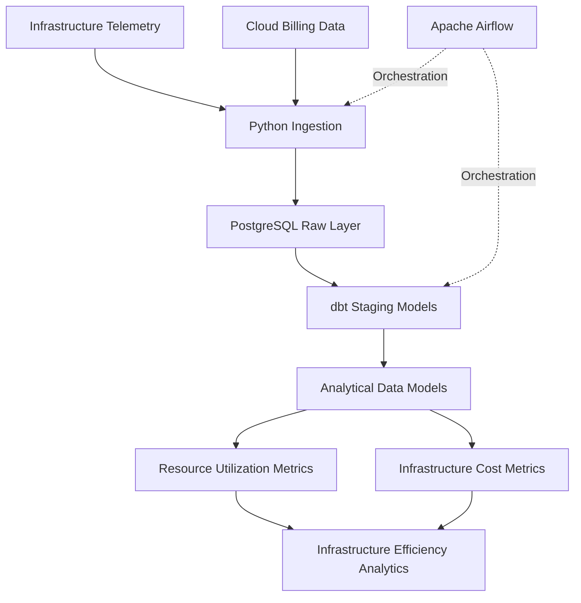

# ☁️ ComputeIQ — Cloud Infrastructure Analytics Platform

An end-to-end data and analytics engineering project designed to measure cloud resource utilization, infrastructure costs, and capacity efficiency.

## 🎯 Project Objectives

Cloud infrastructure generates large volumes of telemetry and billing data. Understanding how efficiently computing resources are utilized is essential for controlling costs, identifying underutilized capacity, and supporting infrastructure planning.

ComputeIQ is designed to answer questions such as:

- Which workloads consume the most infrastructure resources?
- Where is computing capacity underutilized?
- How does resource utilization relate to infrastructure spending?
- Which workloads present potential cost optimization opportunities?
- How reliable and complete is the underlying telemetry data?

## 🛠 Technology Stack

| Technology | Purpose |
|---|---|
| Python | Data ingestion and processing |
| SQL | Analytical transformations |
| PostgreSQL | Data storage |
| dbt | Analytical data modeling and data quality testing |
| Apache Airflow | Workflow orchestration |
| Docker | Containerized execution environments |
| Git | Version control |

## 🏗 System Architecture



Docker provides the containerized environment for the pipeline components.

The architecture represents the target end-to-end design.

## 📊 Analytical Data Model

The analytical model is designed around the following entities:

| Entity | Grain |
|---|---|
| Instances | One row per infrastructure instance |
| Instance Metrics | One row per instance per observation timestamp |
| Workloads | One row per workload |
| Daily Cloud Costs | One row per workload per day |
| Daily Resource Utilization | One row per workload per day |

Separating infrastructure metadata, telemetry, and billing data enables consistent metric definitions and avoids unnecessary duplication.

## 📈 Infrastructure Metrics

The target analytical layer includes:

- Average CPU utilization
- Weighted GPU utilization
- Memory utilization
- Compute capacity consumption
- Daily infrastructure cost by workload
- Cost per unit of utilized capacity
- Underutilized resource capacity
- Telemetry completeness and coverage

## ⚙️ Engineering Design Decisions

### Incremental and Idempotent Ingestion

Process new observations incrementally rather than reloading the entire historical dataset.

Design ingestion logic to support safe reruns without introducing duplicate records.

### Late-Arriving Data

Separate regular incremental ingestion from historical backfill processing to accommodate delayed telemetry observations.

### Resource-Weighted Aggregations

Calculate GPU utilization using GPU-count-weighted averages rather than simple averages across heterogeneous instances.

Treat instances without GPUs as not applicable rather than assigning them zero GPU utilization.

### Data Quality and Coverage

Validate uniqueness, missing observations, metric ranges, and telemetry completeness.

Evaluate data coverage before interpreting utilization and efficiency metrics.

### Consistent Analytical Grain

Aggregate infrastructure telemetry to the workload-day level before joining it with daily billing data to prevent join fanout and inflated cost metrics.

## 📁 Repository Structure

```text
ComputeIQ/
├── dags/
├── data/
│   └── raw/
├── dbt_project/
├── src/
├── Dockerfile
├── docker-compose.yml
├── main.py
├── requirements.txt
└── README.md
```

## 🚧 Development Status

This project is currently in active development.

The current repository contains the foundation for data ingestion, containerized infrastructure, workflow orchestration, and analytical data modeling.

Planned improvements include:

- Complete end-to-end pipeline orchestration
- Automated data quality validation
- Late-arriving data and historical backfill workflows
- Infrastructure efficiency reporting
- Distributed processing with PySpark
- Pipeline observability and automated testing
- Performance and scalability evaluation

## 💡 Motivation

This project explores the intersection of data engineering, analytics engineering, and cloud infrastructure efficiency, with an emphasis on reliable data pipelines, meaningful infrastructure metrics, and scalable system design.
